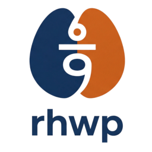

<p align="center">
  
</p>

# RHWP STUDIO

<p align="center">
  <strong>All HWP, at home on your computer</strong>
</p>

<p align="center">
  <strong>RHWP STUDIO</strong> — 100% Standalone Offline HWP/HWPX Document Viewer & Editor<br/>
  <em>Cross-platform HWP/HWPX/HML Document Viewer & Editor powered by rhwp</em>
</p>

<p align="center">
  
  
  
  
</p>

<p align="center">
  <a href="README.md">한국어</a> | <strong>English</strong>
</p>

---

## 🌟 Overview

**RHWP STUDIO** is an open-source, standalone software application designed to view and edit Korean Hancom documents (`.hwp`, `.hwpx`, `.hml`) directly in web browsers and desktop environments without requiring Hancom Office installation.

- **100% Offline & Standalone**: Eliminates external hosting URL dependencies (`edwardkim.github.io`). Equipped with a built-in local bundle (`public/studio`), ensuring complete functionality in offline or air-gapped intranet environments.
- **Port Conflict Prevention**: Adopted dedicated port **`7788`** instead of default Vite port `5173`.
- **Dual Mode (Viewer ↔ Editor)**:
  - 👁️ **Viewer Mode**: Clean, distraction-free reading experience with navigation and zoom controls.
  - ✏️ **Editor Mode**: Full ribbon toolbar, tables, paragraph formatting, font properties, and equation editing.
- **Web & Desktop Integration**:
  - Run as a fast web application at `http://localhost:7788`.
  - Packaged native desktop app for macOS (`.dmg`, `.pkg`) and Windows (`.exe` NSIS installer & Portable).
- **Multi-language Support (i18n)**: One-click instant switching between Korean (한국어) and English (English).

---

## 🥚 What the Logos Mean

| Logo | Meaning |
|:----:|---------|
|  | **rhwp engine — All HWP, Open for Everyone**<br/>"R" sounds like "알" (al), Korean for egg: a beginning, a core, and the root of "알다", to know. It also echoes "All". The egg breaks the shell of a closed format and opens it to everyone. ([Upstream branding document](https://github.com/edwardkim/rhwp/blob/main/mydocs/eng/manual/branding_strategy.md)) |
|  | **RHWP STUDIO — Holding the egg**<br/>The navy and orange shell halves of the rhwp logo open into two pages that hold the egg, the engine. In Korean, "쪽" (jjok) means both "half" and "page". It also stands for keeping your documents on your own computer. |

---

## 🚀 Key Features

### 1. Document Format Compatibility
- **HWP 5.0 Binary**: Parses and renders OLE2 Compound binary documents.
- **HWPX Open XML**: Compliant with KS X 6101 Korean standard word processor markup.
- **HML (HWPML 2.9/2.91)**: Supports structured XML markup format.

### 2. File I/O & Export
- **File Opening**: Native OS file dialog, Drag & Drop, built-in sample document.
- **Document Saving**:
  - Save as `HWP` binary
  - Save as `HWPX` standard XML
  - Save as `HML` XML
- **Export & Print**:
  - Export vector `SVG` page
  - System print dialog and PDF export

---

## ⌨️ Keyboard Shortcuts

| Shortcut (macOS / Windows) | Action |
|----------------------------|--------|
| `Cmd + O` / `Ctrl + O` | Open document (`.hwp`, `.hwpx`, `.hml`) |
| `Cmd + S` / `Ctrl + S` | Save current document as HWP |
| `Cmd + N` / `Ctrl + N` | Create a new blank document |
| `Cmd + M` / `Ctrl + M` | Toggle **Viewer Mode ↔ Editor Mode** |
| `Cmd + P` / `Ctrl + P` | Print document / Save to PDF |

---

## 📦 Installer Packages (`release/` directory)

| OS | File | Format & Purpose |
|:---|:---|:---|
| **macOS** | `RHWP STUDIO-1.0.0-arm64.dmg` | Drag-and-drop disk image installer |
| **macOS** | `RHWP STUDIO-1.0.0-arm64.pkg` | System administrator & enterprise package installer |
| **macOS** | `RHWP STUDIO-1.0.0-arm64-mac.zip` | Standalone portable application archive |
| **Windows** | `RHWP STUDIO Setup 1.0.0.exe` | NSIS setup wizard with desktop & start menu shortcuts |
| **Windows** | `RHWP STUDIO 1.0.0.exe` | Portable single standalone executable |

---

## 🛠️ Getting Started

### Prerequisites
- **Node.js**: v18.0.0+ (v20+ recommended)
- **npm**: v9.0.0+

### 1. Install Dependencies
```bash
npm install
```

### 2. Run in Web Browser (Development)
```bash
npm run dev
```
Open `http://localhost:7788` in your browser.

### 3. Run as Desktop App (Electron Development)
```bash
npm run electron:dev
```

### 4. Build Installers

```bash
# Build macOS installers (.dmg, .pkg, .zip)
npm run dist:mac

# Build Windows installers (.exe Setup, .exe Portable)
npm run dist:win

# Build all platforms simultaneously
npm run dist:all
```
All outputs are created in the **`release/`** directory.

---

## 🔏 Security Warnings During Installation

The installers are not signed with a paid certificate, so the OS shows a warning. Check that you downloaded the file from [GitHub Releases](https://github.com/david80/rhwpsoft/releases) before you continue.

### 🍎 macOS ("Unidentified Developer" Bypass)
Remove the quarantine attribute:
```bash
./scripts/fix-macos-quarantine.sh
```
Or manually:
```bash
xattr -cr "/Applications/RHWP STUDIO.app"
```

### 🪟 Windows (SmartScreen)
Click **More info**, then **Run anyway**. You do not need to install a certificate.

> ⚠️ If you ever ran `install-cert-windows.bat`, remove the certificate it installed. See the [security notice](SECURITY.md#english).

---

## 🖋️ Smart Signature & Stamp Visual Alignment Patch

To resolve an upstream layout issue where floating signature images drift into preceding boxes, RHWP STUDIO includes a built-in non-destructive alignment patch (**[PATCH-001](PATCHES.md#patch-001-스마트-서명-및-직인-위치-자동-보정-smart-signature--stamp-alignment)**).

- **100% Binary Preserving (Non-destructive)**: Does not mutate document coordinates in the HWP binary. Instead, the Canvas renderer intercepts render calls and visually snaps signatures over the `(인)` / `(서명)` anchor. Re-saving or opening documents in original Hancom Office preserves pristine layout integrity.
- **Future Upstream Synchronization**: Once an official layout fix is merged in upstream `edwardkim/rhwp`, this visual patch will be smoothly phased out in favor of the official WASM core.
- **Detailed Patch History**: Please refer to 📄 **[PATCHES.md](PATCHES.md)** for complete technical patch logs and architectural decisions.

---

## 🔒 Security & Privacy

All document parsing, rendering, and editing processes are executed **100% locally** within the client browser / local WASM runtime. No document content is ever sent to external cloud servers.

---

## 📜 License & Trademarks

- **App License**: [MIT License](LICENSE) — Copyright (c) 2026 davidlee
- **Engine License**: [MIT License](public/brand/rhwp-LICENSE.txt) — Copyright (c) 2025-2026 Edward Kim ([edwardkim/rhwp](https://github.com/edwardkim/rhwp))
- **Logos**: The rhwp engine logo is the unmodified original from edwardkim/rhwp ([MIT, © 2025-2026 Edward Kim](public/brand/rhwp-LICENSE.txt)). The RHWP STUDIO logo is a new drawing based on rhwp's meaning and colors. RHWP STUDIO is not an official rhwp distribution.
- **Trademarks**: "Hancom", "Hangul", "HWP", and "HWPX" are registered trademarks of Hancom Inc. This project is an independent open-source software with no official affiliation with Hancom Inc.
